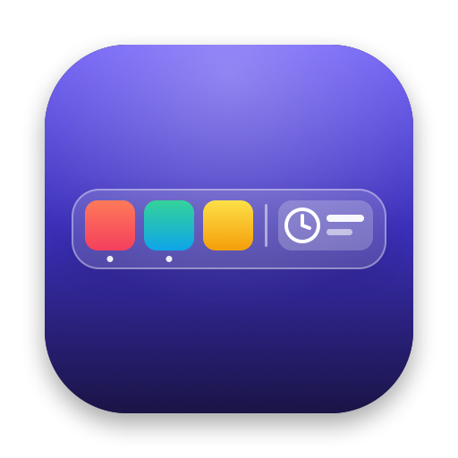

<p align="center"></p>

<p align="center"><a href="README.md">English</a> · <a href="README.es.md">Español</a> · <a href="README.zh-Hans.md">简体中文</a> · <a href="README.ja.md">日本語</a> · <a href="README.de.md">Deutsch</a> · <a href="README.fr.md">Français</a> · <a href="README.pt.md">Português</a></p>

# MyDock

Ein Dock für macOS mit Widgets, Trennlinien und App-Gruppen. Es funktioniert neben dem Apple-Dock oder an seiner Stelle, ohne das System zu verändern.

## Download und Installation

1. Lade **`MyDock-x.y.z.dmg`** von der [neuesten Version](https://github.com/JotaRguezD/MyDock/releases/latest) herunter.
2. Öffne die `.dmg` und ziehe **MyDock** in den Ordner **Programme**.
3. Öffne MyDock aus dem Ordner „Programme“.

### Beim ersten Öffnen

MyDock ist nicht von einem bei Apple verifizierten Entwickler signiert, deshalb öffnet macOS es beim ersten Mal nicht direkt:

- **macOS 15 Sequoia oder neuer**: Es erscheint eine Warnung; klicke auf **Fertig**. Öffne **Systemeinstellungen › Datenschutz & Sicherheit**, scrolle nach unten und klicke neben MyDock auf **Dennoch öffnen**. Bestätige mit deinem Passwort.
- **macOS 14 Sonoma**: Klicke im Ordner „Programme“ mit der rechten Maustaste auf MyDock, wähle **Öffnen** und bestätige.

Das ist nur einmal nötig. Updates werden genauso installiert: Lade die neue `.dmg` herunter und ziehe MyDock in den Ordner „Programme“, um die alte Version zu ersetzen. Deine Einstellungen und Berechtigungen bleiben erhalten.

### Voraussetzungen

- macOS 14 Sonoma oder neuer.
- Jeder Mac: mit Intel-Prozessor oder Apple-Chip (M1, M2, M3 …).

## Funktionen

### Apps, Ordner und Gruppen

- **Apps und Ordner anheften**, indem du sie aus dem Finder ziehst; ein Klick auf einen Ordner öffnet ihn im Finder. Zum Umsortieren ziehst du die Symbole innerhalb des Docks.
- **Geöffnete Apps**: Nicht angeheftete Apps erscheinen automatisch hinter den angehefteten, wie im Apple-Dock. Ein Punkt unter dem Symbol zeigt, dass die App geöffnet ist.
- **Gruppen**: mehrere Apps in einem Symbol; ein Klick öffnet ein kleines Fenster mit allen. Ziehe eine App auf eine Gruppe, um sie hinzuzufügen.
- **Trennlinien und Abstände**: so viele du willst, wo du willst.
- **Papierkorb**, am Ende des Docks wie beim Apple-Dock: Klicke zum Öffnen, lege Dateien darauf ab, um sie in den Papierkorb zu legen, oder ein Dock-Symbol, um es zu entfernen, und Rechtsklick › **Papierkorb entleeren …** (fragt immer nach). Er lässt sich in den Einstellungen ausblenden.
- **Apps und Widgets in getrennten Bereichen**: zuerst die Apps, dann die Widgets, mit einer Trennlinie dazwischen.
- **Animationen**: Beim Öffnen einer App hüpft ihr Symbol, bis sie gestartet ist; Widgets pulsieren kurz, wenn du sie anklickst.

### Kontextmenüs

Menüs öffnen sich direkt über dem Dock mit einem kleinen Pfeil, der auf das Symbol zeigt – wie im Apple-Dock –, und verdecken so nie die Symbole daneben: Rechtsklick auf ein anderes Symbol, und sein Menü öffnet sich sofort. Das gilt für Apps, Widgets, Gruppen, den Papierkorb und den Dock-Hintergrund.

| App | Optionen |
|---|---|
| Geöffnet | Ihre Fenster · ihre wichtigsten Aktionen aus dem Menü „Ablage“ (Neues Fenster, Neues Ereignis …) · **Optionen** › · Ausblenden · **Beenden** · Sofort beenden |
| Angeheftet, geschlossen | Im Finder zeigen · In Gruppe bewegen · Aus dem Dock entfernen · Beenden (ausgegraut) |
| In einer Gruppe, geschlossen | Ins Dock holen · Aus der Gruppe entfernen · Beenden (ausgegraut) |

Unter **Optionen** hat eine geöffnete App dieselben Möglichkeiten wie im geschlossenen Zustand (oder **Im Dock behalten**, wenn sie nicht angeheftet ist). Fenster und Aktionen brauchen die Berechtigung für Bedienungshilfen. Jedes Dock zeigt sein eigenes Menü: Ein Rechtsklick im Apple-Dock öffnet weiterhin das von Apple.

### 16 Widgets

| Grundlagen | Produktivität | System | Werkzeuge |
|---|---|---|---|
| Uhr und Datum | Nächste Termine | Batterie | Downloads |
| Wetter | Erinnerungen | Lautstärke | Bildschirmfotos |
| Musik | Pomodoro | Zwischenablage | Suchen |
| CPU und Speicher | Schnelle Notiz | Festplatte und Netzwerk | Farbpipette |

- **Uhr und Datum**: Ein Klick öffnet den Kalender.
- **Wetter**: für deinen Standort oder deine gespeicherten Städte; Rechtsklick › **Stadt** zum schnellen Wechseln. Ein Klick öffnet die Wetter-App.
- **Musik**: der Titel, der in einer beliebigen App läuft (Spotify, Musik, ein Browser …), mit Tasten für Zurück, Wiedergabe/Pause und Weiter. Ein Klick öffnet die App, die gerade spielt.
- **CPU und Speicher**, **Festplatte und Netzwerk**: Auslastung in Echtzeit; ein Klick öffnet die Aktivitätsanzeige.
- **Nächste Termine**: dein nächster Kalendertermin und wie lange es noch dauert.
- **Erinnerungen**: deine offenen Aufgaben; du kannst sie direkt im Dock als erledigt markieren.
- **Pomodoro**: Timer für Fokus und Pause, mit Ton am Ende.
- **Schnelle Notiz**: ein kurzer Text, der im Dock gespeichert bleibt.
- **Batterie**: Ladestand und ob sie gerade lädt.
- **Lautstärke**: Stummschalten und Lautstärkeregler.
- **Zwischenablage**: was du zuletzt kopiert hast, um es mit einem Klick erneut zu kopieren.
- **Downloads** und **Bildschirmfotos**: deine neuesten Dateien, zum Öffnen oder zum Ziehen in eine andere App.
- **Suchen**: Apps und Dateien finden, ohne Spotlight zu öffnen.
- **Farbpipette**: nimm eine Farbe von einer beliebigen Stelle des Bildschirms auf und kopiere ihren Code.

Jedes Widget kann nur einmal hinzugefügt werden.

### Anpassung

- **Jedes Widget**: **kompakte** (symbolgroße) oder **breite** Version, **Hintergrundfarbe** und eigene Optionen: 12- oder 24-Stunden-Format, Sekunden, Wetter-Städte, °C oder °F, Pomodoro-Minuten, Anzahl der Einträge …
- **Position**: unten, oben, links oder rechts. Oben, unter der Menüleiste, kann es nur mit deinen Widgets neben dem Apple-Dock laufen.
- **Symbolgröße**: klein, mittel oder groß.
- **Automatisch ausblenden**: Das Dock wird ausgeblendet und erscheint wieder, wenn du den Zeiger an den Bildschirmrand bewegst.
- **Verwendetes Dock**: nur MyDock, MyDock und das Apple-Dock, oder zurück zum Apple-Dock.
- **Fenster ans Dock anpassen** (optional): Maximierte Fenster enden dort, wo MyDock beginnt, wie beim Apple-Dock. Wird das Dock automatisch ausgeblendet, nutzen die Fenster den ganzen Bildschirm. Ist eine App im Vollbildmodus, wird MyDock ausgeblendet und erscheint, wenn du den Zeiger an den Rand bewegst.
- **Bei der Anmeldung öffnen**.
- **Heller oder dunkler Modus**: folgt deinem Mac.
- **17 Sprachen**: Englisch, Spanisch, Katalanisch, Galicisch, Baskisch, Französisch, Deutsch, Italienisch, Portugiesisch, Norwegisch, Dänisch, Finnisch, Japanisch, vereinfachtes Chinesisch, Koreanisch, Hindi und Arabisch. Es verwendet die Sprache deines Macs oder die, die du in den Einstellungen wählst.

## Bedienung

- **Rechtsklick auf den Dock-Hintergrund**: Trennlinien, Abstände, Gruppen und Widgets hinzufügen sowie die wichtigsten Optionen (Position, Größe, Ausblenden, verwendetes Dock …).
- **Rechtsklick auf ein Widget**: seine Einstellungen, kompakte oder breite Version und Entfernen.
- **Einstellungen …** (im Rechtsklickmenü des Hintergrunds): ein Fenster mit allen Optionen. Links **Allgemein** und ein Bereich pro Widget; mit der Taste **+** fügst du Widgets hinzu.

> Das Apple-Dock lässt nicht zu, dass du seine Symbole in eine andere App ziehst: Ziehst du eines heraus, wird es entfernt. Füge Apps über den Finder zu MyDock hinzu.

## Berechtigungen

MyDock fragt nur nach einer Berechtigung, wenn etwas sie braucht, und macOS merkt sie sich:

| Für | Berechtigung |
|---|---|
| Wetter für deinen Standort | Ortungsdienste (optional: ohne sie fügst du deine Städte von Hand hinzu) |
| Papierkorb | Finder (um zu wissen, ob der Papierkorb etwas enthält, und ihn zu entleeren) |
| Nächste Termine | Kalender |
| Erinnerungen | Erinnerungen |
| Downloads | Ordner „Downloads“ |
| Bildschirmfotos | Ordner „Schreibtisch“ (oder wo du Bildschirmfotos sicherst) |
| Fenster ans Dock anpassen sowie Fenster und Aktionen einer geöffneten App in ihrem Kontextmenü | Bedienungshilfen |

Lehnst du ab, zeigt das Widget „Keine Berechtigung“; ein Klick öffnet die Einstellung, um sie zu erteilen.

## Datenschutz

- Keine Konten und keine Analysen. Deine Einstellungen werden nur auf deinem Mac gespeichert.
- Das Wetter-Widget sendet an [Open-Meteo](https://open-meteo.com) nur gerundete Koordinaten (etwa 1 km Genauigkeit), um die Temperatur abzurufen. Städtenamen werden über den Kartendienst von Apple gesucht.
- Der Verlauf der Zwischenablage liegt nur im Arbeitsspeicher: Er wird nie auf die Festplatte geschrieben, beim Beenden von MyDock gelöscht und enthält nichts, was Passwortmanager kopieren.

## Sicherheit

- **Hardened Runtime von macOS**: Kein anderes Programm kann Code in MyDock einschleusen, um dessen Berechtigungen auszunutzen. Außerdem kann MyDock nur die Berechtigungen aus der obigen Tabelle anfordern.
- **Signatur**: Alle Versionen sind mit demselben Zertifikat signiert, daher erkennt macOS Updates als dieselbe App und behält deine Berechtigungen.
- **Prüfe, ob die `.dmg` echt ist**: Auf der Seite jeder Version zeigt GitHub den SHA-256-Fingerabdruck der `.dmg` neben ihrem Namen unter *Assets* an. Gib in der App „Terminal“ ein:

  ```bash
  shasum -a 256 ~/Downloads/MyDock-x.y.z.dmg
  ```

  Das Ergebnis muss genau mit diesem Fingerabdruck übereinstimmen. Wenn nicht, öffne sie nicht.
- Lade MyDock nur von der [offiziellen Versionsseite](https://github.com/JotaRguezD/MyDock/releases) herunter.

## Häufige Fragen

**Kann ich das Apple-Dock ausblenden?**
Ja: Rechtsklick › **Verwendetes Dock › Nur MyDock**. Wird MyDock beendet, erscheint das Apple-Dock wieder genau so, wie du es hattest – auch wenn MyDock abstürzt oder sofort beendet wird.

**Wenn ich ein Fenster maximiere, rutscht es unter MyDock.**
Aktiviere **Fenster ans Dock anpassen** unter Einstellungen › Allgemein und erteile die Berechtigung für Bedienungshilfen.

**Warum wird der Titel, den ich höre, nicht angezeigt?**
Das Musik-Widget zeigt, was macOS im Kontrollzentrum unter „Aktuelle Wiedergabe“ anzeigt. Erscheint ein Player dort nicht, kann MyDock ihn auch nicht sehen.

## Deinstallieren

1. Deaktiviere **Bei der Anmeldung öffnen** und wähle **MyDock beenden**. Wenn du „Nur MyDock“ verwendet hast, erscheint das Apple-Dock wieder so, wie du es hattest.
2. Lösche MyDock aus dem Ordner „Programme“.
3. Um auch deine Einstellungen zu löschen, lösche den Ordner `~/Library/Application Support/MyDock`.

## Lizenz

[MIT](LICENSE) © 2026 [JotaRguezD](https://github.com/JotaRguezD)
